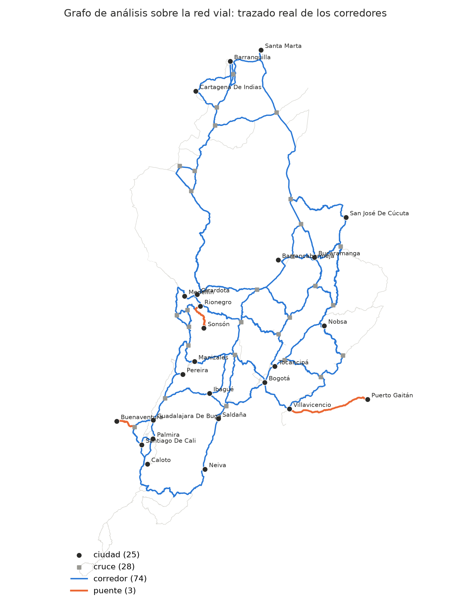

# Vulnerabilidad de la red vial primaria de carga de Colombia

Proyecto del curso **Teoría de Grafos** (prof. Daniel Bojacá, Universidad del Rosario, 2026-II).
Autores: Gabriel Salcedo, Isaac Suárez y David Catal.

La red vial primaria se modela como un grafo ponderado por **costo económico** (COP por
tonelada) para identificar los corredores críticos del transporte de carga y medir cuánto
cuestan las rutas alternas cuando se cierra una vía.



**¿Cómo se llegó a este grafo?** Ver [RECUENTO.md](RECUENTO.md): cada paso, desde la
limpieza de las bases de datos hasta el grafo final, con sus decisiones y cifras.

## Estructura

```
graphs-appl/
├── README.md                        este archivo
├── RECUENTO.md                      paso a paso: de los datos al grafo final
├── environment.yml                  entorno de Python (conda)
├── graphs-appl.Rproj                proyecto de RStudio
├── data/
│   ├── raw/                         datos de origen
│   │   ├── base1.zip, base2.zip     RNDC 2015, comprimido
│   │   ├── invias.zip               red vial primaria INVIAS, comprimida
│   │   └── divipola.csv             municipios y centros poblados (DANE)
│   ├── final/                       salidas de 01_limpieza_rndc.R (las lee Python)
│   │   ├── matriz_od.csv            matriz origen-destino limpia
│   │   ├── nodos_demanda.csv        un punto por municipio + toneladas
│   │   └── costo_por_config.csv     COP por tonelada-km según vehículo
│   └── pruebas/grafo_juguete.json   grafo pequeño con respuestas conocidas
├── scripts/
│   ├── 00_preparar_datos.py         descomprime los datos de data/raw/
│   ├── 01_limpieza_rndc.R           limpia el RNDC y DIVIPOLA -> data/final/
│   ├── 02_construir_grafo.py        red detallada y grafo de análisis
│   ├── 03_criticidad_intermediacion.py  intermediación de aristas (Brandes)
│   ├── 04_validar_grafo.py          propiedades del grafo y validación
│   ├── 05_dibujar_grafos.py         un PNG por grafo
│   ├── 06_pruebas.py                pruebas automáticas
│   ├── ejecutar_todo.py             corre los pasos 02 a 06 en orden
│   ├── app_rutas.py                 (opcional) ventana de rutas de menor costo
│   ├── config.py                    ÚNICO archivo de parámetros
│   └── vial/                        módulos: carga, limpieza, grafo, ciudades,
│                                    costo, rutas (Dijkstra), centralidad, archivos
└── outputs/
    ├── resultados/                  tablas y reportes que producen los scripts
    ├── figuras/                     figuras de los grafos (para los documentos)
    └── reporte_modelamiento/        reporte de datos y modelamiento (LaTeX + PDF)
```

## Cómo reproducir los resultados

**1. Crear el entorno de Python** (Miniconda), desde la carpeta raíz:

```bash
conda env create -f environment.yml
conda activate vial
```

**2. Correr todo el análisis**, desde la carpeta `scripts/`:

```bash
cd scripts
python ejecutar_todo.py           # ~1 min; corre los pasos 02 a 06
```

Cada script también se puede correr solo en Spyder (F5). Esto es lo que produce cada uno:

| Paso | Script | Qué hace | Produce |
|---|---|---|---|
| 0 | `00_preparar_datos.py` | Descomprime `base1.zip`, `base2.zip` e `invias.zip` | `data/raw/*.csv`, `invias.geojson` |
| 1 | `01_limpieza_rndc.R` | Limpia el RNDC y DIVIPOLA (paquetes: here, dplyr, readr, stringr) | `data/final/*.csv` |
| 2 | `02_construir_grafo.py` | Limpia la red, construye la red detallada y el grafo de análisis | `outputs/resultados/grafo.pkl`, `grafo_detallado.pkl`, `reporte_construccion.txt`, `od_ciudades.csv`, `aglomeracion.csv`, `municipios_conexion.csv`, `duplicados_eliminados.csv` |
| 3 | `03_criticidad_intermediacion.py` | Intermediación de aristas y ranking de corredores | `outputs/resultados/criticas_intermediacion.csv`, `criticas_por_via.csv`, `intermediacion_aristas.csv`, `mapa_intermediacion.png`, `barras_intermediacion.png` |
| 4 | `04_validar_grafo.py` | Propiedades del grafo y validación de distancias | `outputs/resultados/validacion.txt`, `validacion_pares_rndc.csv` |
| 5 | `05_dibujar_grafos.py` | Figuras de los grafos | `outputs/figuras/red_detallada.png`, `grafo_analisis_mapa.png`, `grafo_analisis.png` |
| 6 | `06_pruebas.py` | 6 pruebas automáticas | En pantalla: `6/6 pruebas superadas` |

Los pasos 0 y 1 solo hacen falta para rehacer la limpieza en R, porque `data/final/` ya
viene incluido. Desde la raíz: `python scripts/00_preparar_datos.py` y luego
`Rscript scripts/01_limpieza_rndc.R`.

**Todas las figuras y cifras del repositorio salen de estos scripts; ninguna está hecha a
mano.** Los resultados son deterministas: correr dos veces da las mismas tablas y cifras.

## Los grafos

| Figura | Grafo | Tamaño |
|---|---|---|
| `outputs/figuras/red_detallada.png` | Red INVIAS limpia con las 50 ciudades de más carga | 841 nodos, 970 aristas |
| `outputs/figuras/grafo_analisis_mapa.png` | Grafo de análisis con el trazado real de cada corredor | 53 vértices, 77 aristas |
| `outputs/figuras/grafo_analisis.png` | Grafo de análisis como diagrama | 53 vértices, 77 aristas |

El **grafo de análisis** es el que se estudia. Sus vértices son las 25 ciudades o áreas
metropolitanas con más carga más 28 cruces donde se bifurcan las rutas entre ellas. Sus
aristas son los corredores viales, y el peso de cada una es el costo de mover una tonelada
por el corredor. Es conexo y planar, y tiene 3 puentes, entre ellos Buenaventura–Dagua.

## Fuentes de datos

- **Red vial:** INVIAS, red vial primaria, publicada en HDX como
  [Colombia: Roads](https://data.humdata.org/dataset/colombia-roads).
- **Carga:** Registro Nacional de Despachos de Carga (RNDC) 2015, Ministerio de Transporte.
- **Municipios:** DIVIPOLA, DANE.

`invias.zip` pesa 68 MB: GitHub lo acepta (el límite es 100 MB), aunque muestra una
advertencia por pasar de 50 MB. Los archivos de más de 100 MB y los resultados binarios
que se regeneran están en `.gitignore`.
